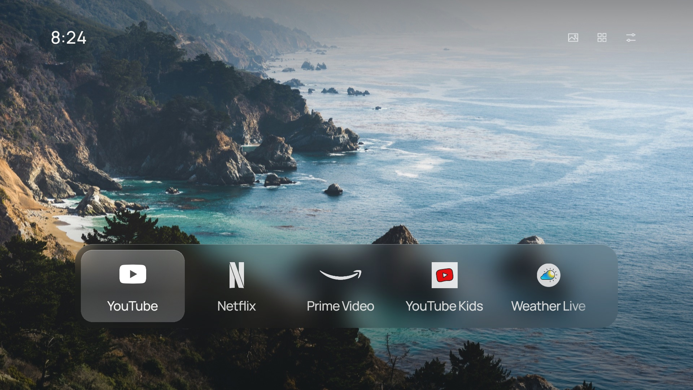
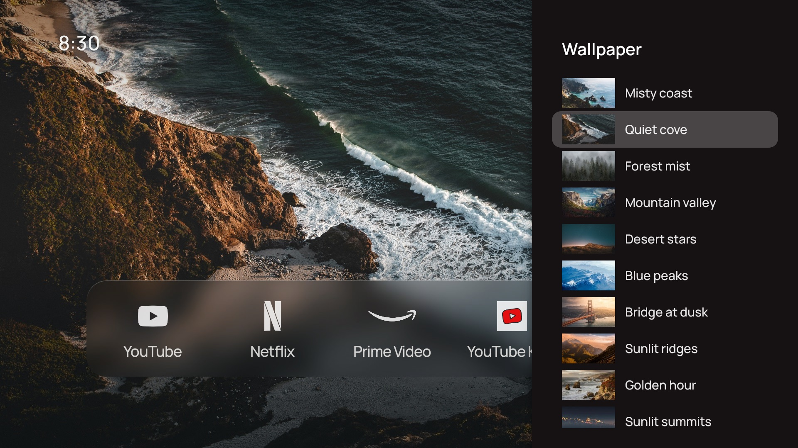

# Sony TV Clean Home

A calm, ad-free home screen for Sony BRAVIA Android TVs: a photograph, a small clock, and your apps and HDMI inputs in a glass dock. Plus a cleanup that turns off Sony's and Google's preinstalled junk, one app at a time, with an undo.



This project joins two others:

- **[TV Detox](https://github.com/Ansub/tv-detox)** by Ansub Khan: an Android TV home screen and the safe install, cleanup and undo scripts. This repo started as a copy of it.
- **[CleanFrame](https://github.com/nthnclrk/CleanFrame)** by Nathan Clark: a home screen for Samsung's The Frame (Tizen). Its look (photos, glass, Manrope, marks, layout) is ported here to Android.

On top of those it adds what a Sony needed:

- **HDMI inputs that show up after a restart.** Sony registers its inputs a few seconds after the home screen starts, so they used to be missing until Home was reopened.
- **A Sony cleanup list** (`sony-cleanup.sh`), checked on a real BRAVIA, including the one app Sony's stock home screen can't live without.
- **Remote navigation that stays put.** Left and Right stop at the ends of the dock and the icon row instead of jumping between them.

> [!WARNING]
> **At your own risk.** This turns off system apps and replaces the home screen. It has been tested on **one TV**: a Sony XBR-55X900C (2015, Android 8.0). Everything can be undone with `undo.sh`, but a TV that gets stuck at the logo may need a factory reset. Read [Notes and warnings](#notes-and-warnings) first.

## What you get

| | |
| --- | --- |
| **Home** | One of 15 photographs, a 12-hour clock, and a glass dock with your apps followed by your HDMI inputs. White brand marks for YouTube, Netflix, Prime Video, Disney+, Max, Apple TV, Spotify, Tubi and Stremio; other apps show their own icon. |
| **Top right** | Wallpaper (browse the photos with a live preview), All apps, and Settings (add an app to Home, brightness, TV settings). |
| **Editing** | Hold OK on an app (or press Menu) to move it, replace it or remove it from Home. |
| **Cleanup** | `sony-cleanup.sh` turns off up to 23 preinstalled apps: Sony Select, the Discover bar, sponsored rows, shut-down Google apps, help apps and partner apps. |
| **Undo** | `undo.sh` turns every app back on and removes the home screen. |



## Set it up

You need a Mac or PC on the same Wi-Fi as the TV, and `adb`:

```sh
brew install android-platform-tools      # Mac. Windows: https://developer.android.com/tools/releases/platform-tools
```

**1. Turn on debugging on the TV.** Settings → About → press OK on **Build** 7 times. Then in **Developer options**, turn on **USB debugging** (and **Network debugging** if your TV has it). Find the TV's IP address under Settings → Network.

**2. Download this repo** and open a terminal in it:

```sh
git clone https://github.com/sspadda/sony-tv-clean-home.git
cd sony-tv-clean-home
```

**3. Install the home screen** with the apps you want in the dock, in order:

```sh
sh install.sh <TV_IP> "com.google.android.youtube.tv,com.netflix.ninja,com.amazon.amazonvideo.livingroom"
```

The first time, the TV asks **Allow USB debugging?** Tick **Always allow** and press **OK**, then run the command again. It downloads the [latest release](https://github.com/sspadda/sony-tv-clean-home/releases/latest), installs it and makes it the default. Sony's stock home screen always wins Home over other apps, so the script then asks before turning it off. Say yes, or Home keeps opening Sony's.

**4. Clean up** (optional). It lists each app and asks before turning it off:

```sh
sh sony-cleanup.sh <TV_IP>
```

**5. Restart the TV once** and check it starts into the new home screen with your HDMI inputs in the dock.

**6. Turn debugging off** in Developer options. While it's on, other devices on your network can ask to control the TV. Turn it back on only to run `undo.sh` or update.

### Undo

```sh
sh undo.sh <TV_IP>
```

This turns back on everything `install.sh` and `sony-cleanup.sh` turned off, removes this home screen, and leaves you with Sony's own.

### Finding package names

`sh candidates.sh <TV_IP>` lists every app on the TV with its package name and a verdict (safe, keep, never, review). Changes nothing.

## What we learned on a Sony

Tested on a **Sony XBR-55X900C**, Android 8.0 (API 26), MediaTek, 1.5 GB RAM, 1920x1080 UI.

- **Sony's stock home screen needs Google's recommendations app.** Turning off `com.google.android.tvrecommendations` leaves its Home tab on *"Content failed to load"*. That's why `sony-cleanup.sh` only offers it once the new home screen is installed.
- **Sony's home screen can't be outranked.** It's a system app with a higher priority than any other home screen, so setting a default isn't enough. `install.sh` turns it off (with your OK). The settings app's fallback home stays behind it as a safety net.
- **HDMI inputs register late after a restart.** Fixed here by listening for TV inputs and rebuilding the dock when they appear.
- **Leave these on.** Hotel/business mode (`com.sony.dtv.b2b.*`) and the Sony/MediaTek device agents (`com.sony.dtv.da.service`, `com.qterics.da.product`, `com.mediatek.*`) look useless but are tied into the system. We didn't turn them off.
- **Memory.** Free memory (including cache) went from about 445 MB to about 600 MB after the cleanup.

Other BRAVIA models from 2015 to 2018 run the same Sony Android TV software and will likely behave the same, but they're **untested**. Newer BRAVIAs run Google TV, where `install.sh` leaves Google's home screen on unless you set `GOOGLE_TV=1`; see [TV Detox's notes](docs/tv-detox-README.md) for those. If you try another model, please open an issue with the model, Android version and what happened.

### Notes and warnings

- **Turn apps off, never uninstall them.** Everything here uses `pm disable-user`, which `undo.sh` reverses. [docs/debloat.md](docs/debloat.md) explains what is safe and why.
- **Don't restart the TV halfway through a cleanup.** Android saves the change a few seconds later.
- **OLED TVs:** keep the screensaver on. A still home screen can burn in.
- **Updates.** A Sony system update can turn apps back on. `sh check.sh <TV_IP> --fix` puts the home screen back.

## Build it yourself

You need Java 17 and the Android SDK (platform 34, build-tools 34):

```sh
brew install openjdk@17 && brew install --cask android-commandlinetools
sdkmanager "platforms;android-34" "build-tools;34.0.0"
sh build.sh            # makes out/tvhome.apk, signed with a key.jks it creates
sh install.sh <TV_IP>  # installs out/tvhome.apk when it exists
```

A build signed with your own key can't update the release app (or the other way round); `install.sh` offers to replace it. The photos, glass, marks and fonts in `assets/` come from CleanFrame through `sh prepare-assets.sh <CleanFrame checkout>`.

| Path | What it is |
| --- | --- |
| `src/com/ansub/tvhome/` | The home screen: `MainActivity` (layout, dock, menus), `Glass` (dock glass and focus plate), `LineIcon` (line icons), `Strings` (translations) |
| `assets/` | Photos, blurred glass, thumbnails, brand marks, Manrope, and their notices |
| `install.sh`, `undo.sh`, `check.sh`, `candidates.sh` | From TV Detox, pointed at this app |
| `sony-cleanup.sh` | The Sony cleanup |
| `docs/tv-detox-README.md` | TV Detox's original README, with help for other brands and Google TV |

## Credits and licences

- Code: MIT, see [LICENSE](LICENSE). Based on [TV Detox](https://github.com/Ansub/tv-detox) (MIT, © Ansub Khan) and the design of [CleanFrame](https://github.com/nthnclrk/CleanFrame) (MIT, © Nathan Clark).
- Photographs: from CleanFrame, by the photographers credited in [assets/notices/photos.json](assets/notices/photos.json), under the [Unsplash License](https://unsplash.com/license).
- Manrope: SIL Open Font License 1.1, [assets/notices/manrope-OFL.txt](assets/notices/manrope-OFL.txt).
- Brand marks: [Simple Icons](https://simpleicons.org) (CC0) and [Custom Brand Icons](https://github.com/elax46/custom-brand-icons) (MIT), as listed in [assets/notices/SOURCES.json](assets/notices/SOURCES.json). The marks belong to their owners and are used only to identify the apps.

Not affiliated with Sony, Google, Samsung or any streaming service.
